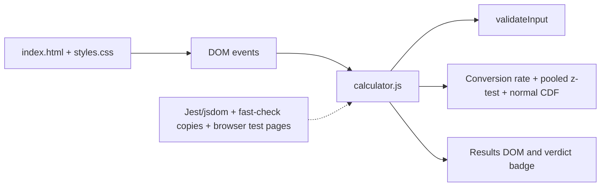

# ExperimentLens Phase 0 Baseline Report

**Repository:** `Deekshithaa-Y-M/ab-test-calculator`  
**Baseline date:** 2026-10-29  
**Phase:** 0 — Project control and baseline  
**Status:** Baseline captured; no product features changed

> The requested project name is **ExperimentLens**, while the inspected repository is
> currently named **ab-test-calculator**. This report treats the existing calculator as
> the starting point for ExperimentLens and does not rename the repository in Phase 0.

## 1. Baseline executive summary

The current product is a static, single-page A/B significance calculator implemented
with vanilla HTML, CSS, and JavaScript. It accepts visitor and conversion counts for a
control and variant group, calculates conversion rates, a pooled two-proportion
z-score, and a rounded two-tailed confidence percentage, then displays a threshold
verdict.

The implementation is small and easy to host, but statistical logic, validation,
state, and DOM rendering are coupled in one script. There is no API, persistence,
experiment model, audit trail, server-side validation, CI workflow, or reproducible
Python environment. The existing test suite is present but could not be executed in
this environment because Node.js and npm are unavailable.

**Phase 0 decision:** migrate incrementally. Preserve the current calculator UI and
user-facing behavior first, establish a Python statistical contract with reference
fixtures, then introduce the FastAPI boundary and React/TypeScript frontend. Do not
add enterprise experimentation, authentication, collaboration, or warehouse features
until the core analysis contract is reliable.

## 2. Current architecture

### Runtime boundaries

| Area | Current implementation | Persistence/network |
|---|---|---|
| Presentation | `index.html`, `styles.css` | None; Inter font is fetched from Google Fonts |
| Interaction/state | DOM listeners and a module-level `state` object in `calculator.js` | In-memory only |
| Validation | `validateInput()` and input event handlers | Client-side only |
| Statistics | JavaScript arithmetic and an Abramowitz–Stegun normal-CDF approximation | Client-side only |
| Tests | Jest/jsdom, fast-check, browser HTML runners, standalone Node runner | No CI workflow found |
| Data | Four scalar input values and a transient result object | No storage |

## 3. Function-by-function behavior

| Function | Current behavior |
|---|---|
| `validateInput(visitors, conversions)` | Converts both values with `Number()`, allows empty values for typing, rejects NaN, negative values, and conversions greater than visitors. It does not enforce integer counts or finite values. |
| `calculateConversionRate(conversions, visitors)` | Returns `0.0` for zero visitors; otherwise returns `(conversions / visitors) * 100`, rounded numerically to one decimal place. |
| `calculateZScore(controlVisitors, controlConversions, variantVisitors, variantConversions)` | Computes the pooled two-proportion z-score as `(p1 - p2) / SE`; returns zero for zero visitors, identical rates, zero conversions in both groups, pooled proportions of 0 or 1, or zero standard error. |
| `normalCDF(z)` | Uses an Abramowitz–Stegun-style approximation to estimate the standard normal cumulative probability. |
| `zScoreToConfidence(zScore)` | Uses a two-tailed calculation based on `abs(z)`, converts to a percentage, and rounds to an integer. |
| `handleInputValidation(visitorsInput, conversionsInput, groupType)` | Validates a group on every input event; stores valid values in shared state, or restores the previous pair and renders an inline error. |
| `showInputError(cardElement, message)` | Replaces the card’s existing error message with a text-only error element. |
| `displayResults(results)` | Writes both rates, confidence, shows the results section, and delegates verdict rendering. |
| `showVerdict(confidence)` | Uses a strict `confidence > 95` threshold for the green “Significant Winner!” badge; otherwise shows the gray “Not Significant yet” badge. |
| `clearResults()` | Resets displayed values, removes verdict classes, clears verdict text, and hides results. |
| `showError(message)` | Replaces the results content with an error message and shows the results section. |
| `performAnalysis(controlData, variantData)` | Validates both groups, rejects incomplete data, converts values, calculates rates/z-score/confidence, creates a result object, renders it, and returns it. |

## 4. Current user-visible behavior

Verified by source inspection:

1. The page renders two cards: “Group A (Control)” and “Group B (Variant)”.
2. Each card contains Visitors and Conversions number inputs.
3. Input changes validate the pair and clear prior results.
4. Invalid values restore the last valid pair for that group and show an inline error.
5. Clicking **Calculate Significance** with incomplete data shows an error in the results area.
6. Valid calculations display control rate, variant rate, confidence, and a verdict badge.
7. Zero visitors produce a `0.0%` rate for that group and `0%` confidence rather than `NaN`.
8. Equal rates and zero conversions in both groups produce a zero z-score/confidence.
9. Confidence greater than 95 (after integer rounding) shows “Significant Winner!”.
10. Editing any input hides and resets previous results.
11. The layout is two-column above 640px and one-column at or below 640px.
12. The interface uses semantic labels, focus outlines, live regions, and screen-reader-only descriptions in the markup.

The application does **not** currently display p-values, confidence intervals, absolute
uplift, or relative uplift, despite those being described in the current upstream
README. Those claims are not supported by the checked-out source.

## 5. Test baseline

### Test inventory

| Test surface | Files | Intended coverage |
|---|---|---|
| Jest unit tests | `calculator.unit.test.js` | jsdom UI, styling, zero/identical-rate edge cases |
| Jest property tests | `calculator.properties.test.js` | Validation, z-score, conversion-rate, confidence, verdict, and state properties |
| Standalone runner | `run-tests.js` | Validation property checks without npm packages |
| Browser runners | `test-runner.html`, `test-confidence.html`, `test-property-10.html`, `unit-tests.html` | Manual/browser execution of selected properties and UI checks |
| Manual checklists | `FINAL-TESTING-CHECKLIST.md`, `MANUAL-TEST-GUIDE.html` | Responsive, accessibility, and cross-browser checks |

### Commands attempted

| Command | Result |
|---|---|
| `npm test -- --runInBand` | **Not executed:** PowerShell reports `npm` is not recognized |
| `node run-tests.js` | **Not executed:** PowerShell reports `node` is not recognized |

No pass/fail count is claimed for this baseline. The repository documentation says
the tests pass, but those historical claims were not reproducible in the current
environment. Installing Node.js/npm or running the browser fixtures is required before
the baseline can be marked executable.

### Test-quality observations

- Several property tests reimplement production functions locally rather than importing
  the implementation. They can therefore pass while `calculator.js` is broken.
- The Jest setup injects the script into jsdom but does not expose a clean module API;
  statistical behavior is not tested as a reusable library contract.
- Browser/manual artifacts duplicate overlapping coverage and have no automated CI
  entry point.
- No test currently establishes agreement with a trusted SciPy/statsmodels reference.

## 6. Known defects and limitations

### Functional/statistical defects

1. **Count validation is incomplete.** Visitors and conversions represent counts, but
   validation permits decimal values and non-finite numeric values at the JavaScript
   function boundary. The HTML `step="1"` is only a browser hint.
2. **The significance verdict uses rounded confidence.** `zScoreToConfidence()` rounds
   before `showVerdict()` compares with 95, so the decision boundary is based on a
   display value rather than the underlying p-value/confidence.
3. **Zero visitors are silently represented as 0%.** This avoids division by zero but
   can be misread as a measured conversion rate; the requirements allow messaging or
   a default, but the current UI gives no “not estimable” indication.
4. **No p-value or interval is exposed.** A confidence percentage alone is less
   auditable than the underlying two-sided p-value and interval.
5. **The normal approximation is used without sample-size warnings.** Small counts and
   rare events may require Wilson, continuity-corrected, or exact methods.
6. **No alternative or method metadata is recorded.** Results cannot explain the
   statistical test, alpha, tail choice, or assumptions used.

### Engineering and product limitations

1. All validation, statistical computation, state, and DOM manipulation are coupled in
   one 422-line script.
2. There is no backend validation boundary; a client can submit values that differ
   from browser constraints.
3. There is no experiment/run data model, persistence, export, or reproducibility
   record.
4. There is no package lockfile, Python project metadata, Docker setup, GitHub Actions,
   Ruff, mypy, pytest, Hypothesis, Playwright, or frontend test command beyond Jest.
5. Google Fonts creates an external runtime dependency despite the “offline” positioning
   in the design documentation.
6. Accessibility, responsive layout, and browser compatibility are documented as
   manual checklists, not verified automated gates.
7. The local branch is `main` and is two commits behind `origin/main`; upstream has
   README commits not present locally. This must be reconciled before migration work is
   based on the upstream documentation.

## 7. Technical debt and migration risks

| Risk | Impact | Mitigation |
|---|---|---|
| JavaScript and Python may disagree at edge cases | High | Freeze JSON fixtures from the current behavior, then add SciPy/statsmodels reference fixtures and an explicit compatibility policy |
| Rounded confidence drives the verdict | High | Define verdict from unrounded p-value/alpha; retain a compatibility mode only if required |
| Hidden input coercion behavior (`Number`) | Medium | Define strict integer, finite, non-negative schemas at the API boundary |
| Tests duplicate implementation | High | Extract pure functions and test imports directly; use Hypothesis and reference values |
| Zero-visitor semantics are ambiguous | Medium | Define an explicit estimability status and UI copy before backend contract finalization |
| No reproducible toolchain | High | Add lockfiles, Python version policy, CI, and Docker after the initial backend skeleton |
| Current branch is stale relative to origin | Medium | Reconcile upstream changes in a dedicated synchronization commit before feature branches |
| Static UI is tightly coupled to DOM IDs | Medium | Move presentation to React components after the statistical API contract is stable |

## 8. Phase 0 project scope

### In scope for the migration

- Preserve the core two-group A/B analysis workflow.
- Accept visitors and conversions for control and variant.
- Validate finite, non-negative integer counts with conversions less than or equal to visitors.
- Return conversion rates, absolute/relative uplift, two-sided p-value, confidence,
  z-score, and a clear significance decision.
- Make the statistical method, alpha, tail, assumptions, and edge-case status explicit.
- Provide a versioned FastAPI JSON contract and a React/TypeScript client.
- Establish pytest, Hypothesis, frontend tests where useful, Playwright smoke tests,
  Ruff, mypy, GitHub Actions, and Docker.
- Start with SQLite for optional local run records; keep PostgreSQL compatibility as a
  later deployment concern.

### Explicitly out of scope

- User accounts, SSO, RBAC, teams, billing, or multi-tenant administration.
- Experiment assignment, traffic allocation, feature flags, or event collection.
- Streaming ingestion, warehouse connectors, scheduled jobs, or real-time dashboards.
- Automatic “winner” rollout decisions or causal inference beyond the selected test.
- Collaborative editing, comments, notifications, and enterprise audit/compliance
  programs.
- PostgreSQL deployment and production-scale orchestration in the first migration.

## 9. Agreed technology stack

| Layer | Decision | Initial rationale |
|---|---|---|
| Frontend | React + TypeScript | Typed components and testable state while preserving the current simple workflow |
| API | Python + FastAPI | Explicit request/response schemas and a small service boundary |
| Statistics | NumPy + SciPy + statsmodels | Trusted numerical primitives and statistical reference implementations |
| Tabular data | pandas initially; Polars only if profiling justifies it | Familiar, low-risk analysis ergonomics |
| Storage | SQLite initially; PostgreSQL later | Local reproducibility without premature operational complexity |
| Testing | pytest + Hypothesis + Playwright; Vitest/Jest only where frontend coverage needs it | Separate statistical, API, and browser responsibilities |
| Quality | Ruff + mypy + GitHub Actions | Fast, reproducible formatting/lint/type/test gates |
| Packaging/runtime | Docker and a pinned Python version | Consistent local and CI execution |

## 10. Migration plan

1. **Baseline freeze:** reconcile `origin/main`, install the supported toolchain, run
   the existing JavaScript tests, and capture reference fixtures for representative
   and edge-case inputs.
2. **Statistics core:** add a Python package with typed input/result models and pure
   functions. Implement the two-proportion analysis using SciPy/statsmodels and define
   zero-visitor, zero-count, small-sample, and invalid-input semantics.
3. **Contract tests:** expose a versioned analysis schema and test it with pytest,
   Hypothesis, and fixed JavaScript compatibility fixtures where behavior is retained.
4. **FastAPI backend:** add `POST /api/v1/analyses` (or equivalent), structured
   validation errors, health checks, and optional SQLite run persistence.
5. **Frontend migration:** rebuild the current form/results flow in React/TypeScript;
   preserve labels, keyboard behavior, responsive layout, and clear-on-edit behavior.
6. **End-to-end verification:** add Playwright smoke coverage, compare backend results
   against trusted reference values, and run CI quality gates.
7. **Hardening and documentation:** containerize, document local setup and supported
   methods, then remove the legacy JavaScript calculation path only after parity and
   acceptance checks pass.

## 11. Branch and commit strategy

### Branches

- `main`: protected, releasable baseline only.
- `phase-0/baseline`: this report and baseline evidence, if Phase 0 is developed
  separately from `main`.
- `feature/<short-name>`: one focused migration slice, for example
  `feature/python-statistics-core` or `feature/fastapi-analysis-api`.
- `fix/<short-name>`: narrowly scoped defect corrections.
- `chore/<short-name>`: tooling, dependency, or CI work.

Keep branches short-lived and merge through pull requests. Reconcile the current
two-commit local lag against `origin/main` before creating migration branches.

### Commits

Use imperative Conventional Commit prefixes:

- `feat:` user-visible capability
- `fix:` defect correction
- `test:` tests or fixtures
- `refactor:` behavior-preserving restructuring
- `docs:` documentation
- `chore:` tooling/dependencies/CI

Each commit should be one coherent change, include tests or a documented reason they
cannot yet run, and avoid mixing formatting or unrelated cleanup with migration work.

## 12. Phase 0 acceptance criteria

- [x] Current JavaScript architecture and every current function are documented.
- [x] Existing test commands were attempted; missing Node.js/npm is documented.
- [x] Current user-visible behavior and test inventory are recorded.
- [x] Known defects, technical debt, and migration risks are listed.
- [x] A concrete frontend-to-Python migration plan is defined.
- [x] Recommended technology stack is selected for the initial migration.
- [x] Enterprise features and other unnecessary scope are explicitly excluded.
- [x] Branch and commit conventions are defined.
- [ ] Existing Jest and standalone tests have an executable pass/fail baseline.
- [ ] Local `main` has been reconciled with `origin/main`.
- [ ] Statistical reference fixtures have been captured.

The final three unchecked items are deliberate follow-up prerequisites, not Phase 0
feature work. They require a Node.js/npm environment and a decision to synchronize the
local branch with upstream.
